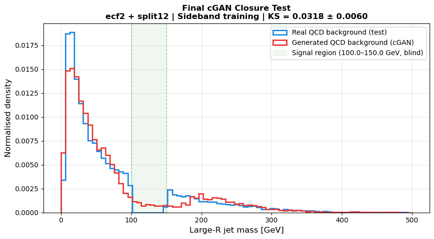
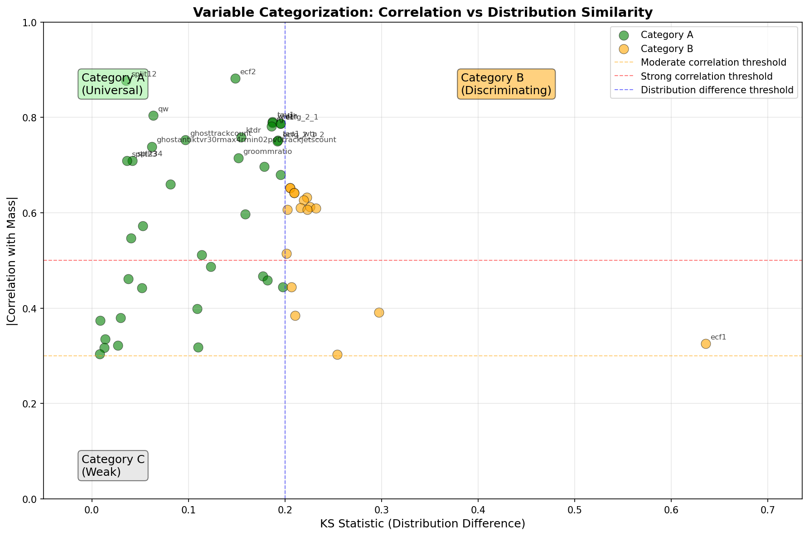
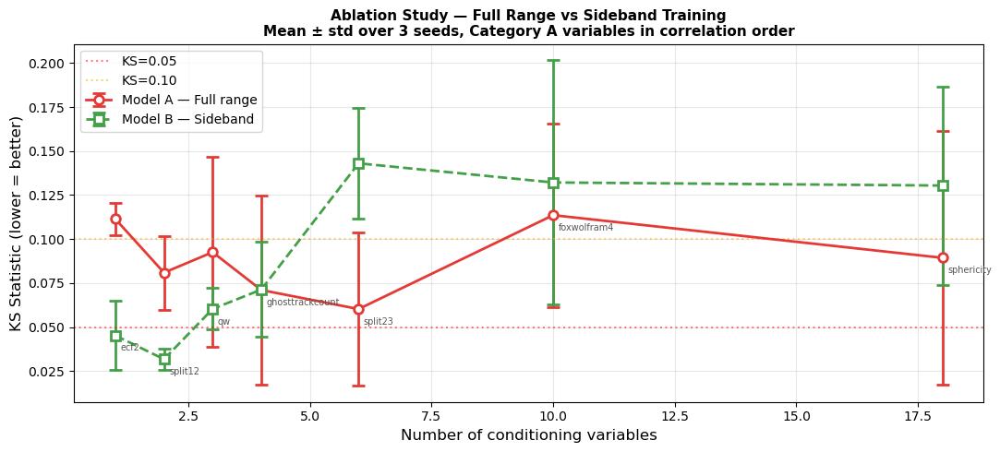
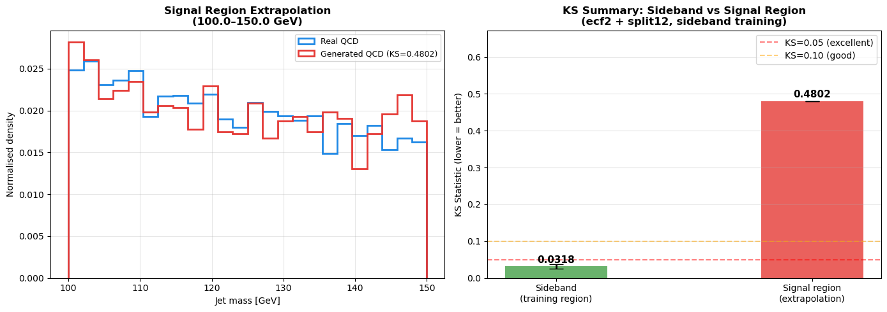

# Conditional GAN for QCD Background Modelling in ATLAS H→bb̄

A conditional Generative Adversarial Network (cGAN) that learns the **large-*R* jet mass distribution of QCD multijet background** from simulated ATLAS events, as a data-driven alternative to fitting a smooth analytic function under the Higgs peak.

> UCL PHAS0052 group project. Python · PyTorch · uproot / awkward · scikit-learn · SciPy

<p align="center">
  
</p>

---

## Motivation

In a boosted H→bb̄ search the Higgs shows up as a narrow bump near 125 GeV in the jet mass spectrum, sitting on top of a large, smoothly falling QCD background. How well that background is modelled sets how well the signal can be extracted.

Instead of a parametric fit, the cGAN learns **P(mass | jet substructure)** from background events. Two choices keep it from inventing a fake signal:

1. **Only signal-agnostic conditioning variables.** These are strongly correlated with mass but have similar shapes in signal and background.
2. **Sideband training.** The 100–150 GeV signal window is blinded during training, and the model has to extrapolate into it.

## Approach

### 1. Variable selection ([`01_variable_selection.ipynb`](notebooks/01_variable_selection.ipynb))

Over 100 jet substructure variables are screened on the leading (highest-*p*<sub>T</sub>) large-*R* jet:

| Step | Metric | Purpose |
|---|---|---|
| Correlation with mass | Pearson *r* on background | Does the variable carry information about mass? |
| Signal vs background shape | Two-sample Kolmogorov–Smirnov statistic | Would conditioning on it leak signal-like information? |

Variables are then sorted into three categories:

- **Category A (universal):** |*r*| > 0.3 and KS < 0.2. Used as cGAN inputs.
- **Category B (discriminating):** correlated with mass, but signal and background shapes differ.
- **Category C (weak):** too little correlation with mass to be useful.

<p align="center">
  
</p>

The strongest Category A predictors are `ecf2` (energy correlation function, *r* ≈ 0.88) and `split12` (*k*<sub>t</sub> splitting scale, *r* ≈ 0.88). Both have almost identical signal and background shapes.

### 2. Conditional GAN ([`02_conditional_gan.ipynb`](notebooks/02_conditional_gan.ipynb))

```
Generator     : [x (conditioning vars) | z ~ N(0,1)^8] → 128 → 128 → mass      (LeakyReLU 0.2)
Discriminator : [x (conditioning vars) | mass]          → 128 → 128 → logit     (LeakyReLU 0.2)
```

- Training: binary cross-entropy, Adam (lr = 2×10⁻⁴, β = (0.5, 0.999)), batch size 1024, 50 epochs
- Data: 79,997 background jets after quality cuts, with a 70/15/15 train/val/test split and scalers fitted on train only
- **Model A** is trained on the full mass range. **Model B** is trained on the sidebands only (mass < 100 or > 150 GeV, 70,049 jets).
- Evaluation: KS statistic between real and generated mass, given as mean ± std over 3 random seeds

The notebook also includes:
- an **ablation study** that adds conditioning variables one at a time in order of correlation strength
- a **baseline comparison** against an exponential fit *f(m) = A·e<sup>−bm</sup>*

## Results

| Configuration | Conditioning variables | KS (lower is better) |
|---|---|---|
| Model A: full-range training | 18 Category A | 0.089 ± 0.072 |
| Model B: sideband training | 18 Category A | 0.130 ± 0.056 |
| Exponential fit (sideband test set) | n/a | 0.080 |
| **Final model: sideband training** | **`ecf2` + `split12`** | **0.032 ± 0.006** |

**Fewer variables worked better.** In the ablation study, sideband training reached its best KS with only two variables (`ecf2`, `split12`). Adding more variables increased both the KS and the seed-to-seed variance. The best full-range model used 6 variables (KS = 0.060).

<p align="center">
  
</p>

**Extrapolation into the blinded window is the open problem.** The final model reproduces the background very well in the sidebands where it was trained (KS = 0.032). Inside the blinded 100–150 GeV region, the generated shape deviates clearly from the true QCD distribution (KS = 0.48). The sideband model learns the conditional mapping well where it has data but does not yet carry it across the gap. That limitation would need to be solved before this could replace a fit in a real analysis.

<p align="center">
  
</p>

Possible next steps:
- Wasserstein-GAN or normalising-flow generators for more stable training
- Interpolation-aware training, e.g. conditioning on mass-decorrelated features
- Testing on samples with signal injected

## Repository structure

```
├── notebooks/
│   ├── 01_variable_selection.ipynb   # correlation + KS study, Category A/B/C
│   └── 02_conditional_gan.ipynb      # cGAN training, closure tests, ablation, baseline
├── figures/                          # key plots exported from the notebooks
├── requirements.txt
└── README.md
```

## Running the notebooks

```bash
pip install -r requirements.txt
jupyter lab
```

**Data is not included.** The notebooks read simulated ATLAS DAOD ROOT files (`CollectionTree`, AntiKt10 UFO CSSK soft-drop jets) that were provided for the course. Put them in `notebooks/background/*.root` and `notebooks/signal/*.root` to re-run everything. The saved outputs and plots in the notebooks can be viewed on GitHub without the data.

## Acknowledgements

Group project for UCL PHAS0052, using ATLAS simulated samples supplied by the course.
